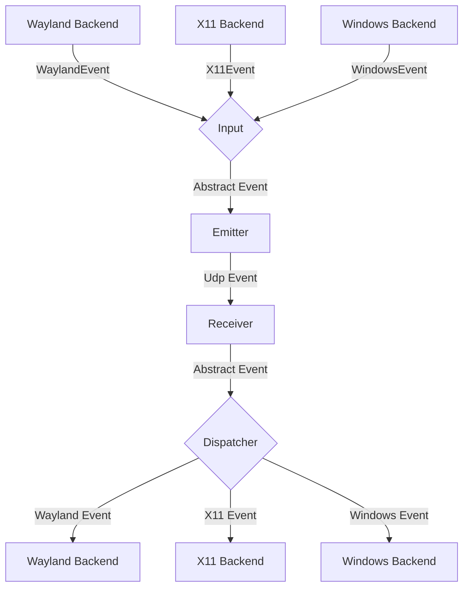
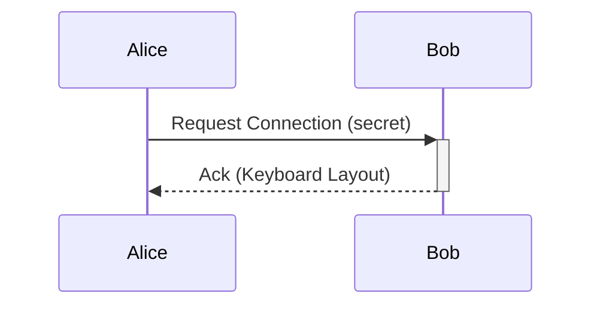

# General Software Architecture

## Clipboard transfer architecture

Clipboard v1 remains the active compatibility path: UTF-8 text up to 4 KiB is
carried in one DTLS datagram. Large application data must not use that path,
because the DTLS implementation does not fragment or retransmit application
records.

The clipboard-v2 protocol lives in
`mousehop-proto::clipboard_transfer`. It defines bounded offers and reliable
stream frames for UTF-8 text, PNG images, and file trees. Mouse/keyboard and
small control messages stay on DTLS; bulk payloads use a separate,
authenticated reliable stream. `CAP_CLIPBOARD_V2`, `CAP_CLIPBOARD_IMAGE`, and
`CAP_CLIPBOARD_FILES` are advertised independently so mixed-version peers skip
formats they cannot publish.

Bulk receivers must validate `TransferLimits` before accepting an offer, write
file chunks into a transfer-specific staging directory, verify item digests,
and only publish the resulting local paths to the OS clipboard after the whole
transfer completes. Manifest paths are normalized relative `/` paths; absolute
paths, traversal components, Windows drive roots, and backslashes are rejected
by the protocol codec. Symbolic links and special filesystem entries are not
sent. Received file trees carry a shared lifetime lease: replacing the local
clipboard releases its lease, while in-flight fan-out tasks retain theirs, and
the staging directory is removed only after the last lease is dropped.

The transport implementation is split between
`mousehop::clipboard_bulk` and `mousehop::clipboard_receive`. Bulk frames use
u32 length prefixes over a reliable byte stream and AES-256-GCM with a
one-transfer key delivered by the authenticated control channel. Nonces are
domain-separated by stream direction and monotonically sequenced; the transfer
ID and sequence are authenticated as associated data. The transfer key and
ephemeral TCP port are carried only in the authenticated DTLS offer. The
receiver bounds the
encrypted length before allocation, streams chunks to a fresh temporary
directory, requires contiguous offsets, and verifies SHA-256 before making an
item complete. The source waits for a completion acknowledgement before
considering the copy delivered.

`input-capture::clipboard` queries the OS clipboard in file-list, bitmap, then
text order. This preserves native file copies that also expose a URI-list text
fallback. `arboard` maps the file list to CF_HDROP on Windows, file URLs on
macOS, and `text/uri-list` on Linux. Bitmaps are normalized to RGBA8 in memory,
encoded losslessly as PNG for transfer, and decoded only after the offer,
payload size, dimensions, and digest have passed validation.

## UI localization

`mousehop-gtk/translations/zh-TW.tsv` maps English message keys to Traditional
Chinese. `mousehop-gtk/build.rs` compiles English and translated GTK resource
bundles; the frontend registers the selected bundle before initializing any
composite templates. Runtime labels and native tray menus use the same catalog.
Missing translations fall back to English. Named placeholders must be retained
in translated messages. The language preference is local to the frontend and
requires a restart, so daemon and protocol serialization are unchanged.

To add another language, add a catalog, compile its resource bundle, extend the
language selection/resolution in `src/i18n.rs`, and register the corresponding
bundle during frontend startup. Catalog tests check duplicate keys and placeholder
consistency; resource tests check translated templates and markup.

## Events

Each instance of mousehop can emit and receive events, where
an event is either a mouse or keyboard event for now.

The general Architecture is shown in the following flow chart:

### Input
The input component is responsible for translating inputs from a given backend
to a standardized format and passing them to the event emitter.

### Emitter
The event emitter serializes events and sends them over the network
to the correct client.

### Receiver
The receiver receives events over the network and deserializes them into
the standardized event format.

### Dispatcher
The dispatcher component takes events from the event receiver and passes them
to the correct backend corresponding to the type of client.

### macOS Caps Lock

Quartz-injected Caps Lock events do not reliably enter the hardware-only path
that macOS uses for its “Caps Lock to switch input sources” setting. They can
toggle the uppercase latch instead, or change the active input method without
refreshing the menu-bar indicator.

When macOS receives a complete remote Caps Lock press from Windows, Mousehop
therefore consumes the down/up pair and switches through Text Input Source
Services on release. A non-Latin input source switches to macOS's most recently
used ASCII-capable source; the next press returns to the most recently observed
non-ASCII source. When Mousehop starts while a Latin source is active, it reads
macOS's input-source history to recover the previously used non-Latin source;
it does not choose the first non-Latin source from the enabled list. Since
Mousehop never injects AlphaShift for this path, a
remote tap cannot accidentally enable continuous uppercase typing. Carbon's
input-source selection updates the system input source and its menu-bar state
together. This uses the existing keyboard protocol.

Manual regression check: with ABC and a Chinese input method enabled on the
Mac, control it from Windows and press/release Caps Lock repeatedly. After each
press, verify both typed characters and the menu-bar input-source icon. Also
verify that holding Caps Lock does not start key repeat and that crossing or
disconnecting with Caps Lock released does not trigger an extra switch.

When macOS controls a remote peer, Mousehop temporarily adds a system HID usage
mapping from physical Caps Lock to F18. macOS implements “Caps Lock to switch
input sources” below the Quartz event-tap interception point, so dropping the
Quartz event alone cannot suppress it. The mapped F18 bypasses that handler;
Mousehop translates it back to Caps Lock only on the wire and drops it locally.
The complete pre-existing `UserKeyMapping` property is restored when capture
returns, the client disconnects, the event tap is interrupted, or Mousehop
shuts down. The Windows sink treats Caps Lock as a discrete lock key and never
starts its synthetic repeat timer for it. This makes the Windows lock state
toggle once per press while the Mac's input source and uppercase state remain
unchanged.

Manual regression check: set the Mac's Caps Lock action first to the normal
uppercase latch and then to input-source switching. In each mode, move capture
to Windows and press Caps Lock repeatedly, including short taps and long holds.
Verify that Windows toggles uppercase once per press, the Mac menu-bar input
source icon does not move, and returning the pointer to the Mac does not reveal
a changed local uppercase state.

## Requests

// TODO this currently works differently

Aside from events, requests can be sent via a simple protocol.
For this, a simple tcp server is listening on the same port as the udp
event receiver and accepts requests for connecting to a device or to
request the keymap of a device.

## Problems
The general Idea is to have a bidirectional connection by default, meaning
any connected device can not only receive events but also send events back.

This way when connecting e.g. a PC to a Laptop, either device can be used
to control the other.

It needs to be ensured, that whenever a device is controlled the controlled
device does not transmit the events back to the original sender.
Otherwise events are multiplied and either one of the instances crashes.

To keep the implementation of input backends simple this needs to be handled
on the server level.

## Device State - Active and Inactive
To solve this problem, each device can be in exactly two states:

Either events are sent or received.

This ensures that
- a) Events can never result in a feedback loop.
- b) As soon as a virtual input enters another client, mousehop will stop receiving events,
which ensures clients can only be controlled directly and not indirectly through other clients.
