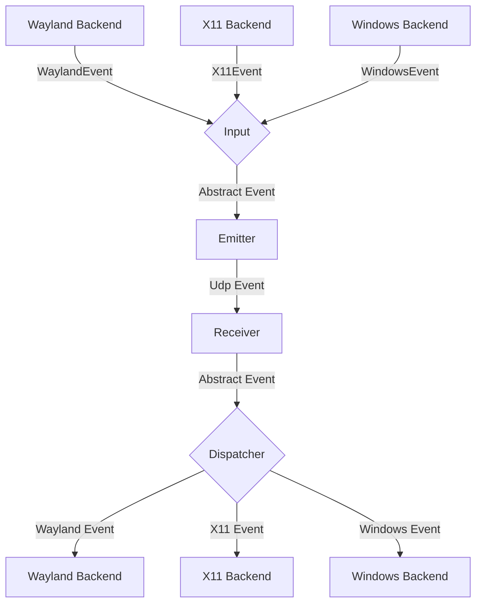
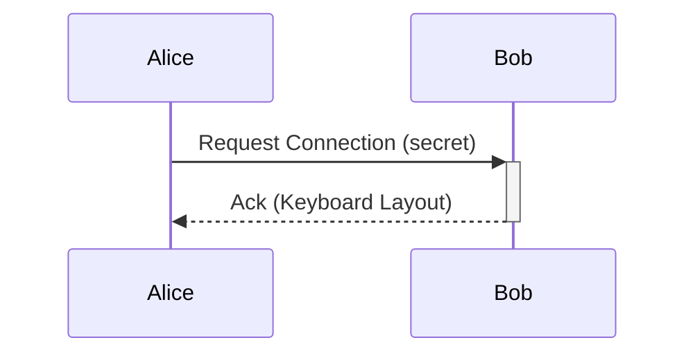

# General Software Architecture

## Clipboard transfer architecture

Clipboard v1 remains the active compatibility path: UTF-8 text up to 4 KiB is
carried in one DTLS datagram. Large application data must not use that path,
because the DTLS implementation does not fragment or retransmit application
records.

The clipboard-v2 protocol lives in
`mousehop-proto::clipboard_transfer`. It defines bounded offers and reliable
stream frames for UTF-8 text, PNG images, and file trees. Mouse/keyboard and
small control messages stay on DTLS; bulk payloads use a separate,
authenticated reliable stream. `CAP_CLIPBOARD_V2`, `CAP_CLIPBOARD_IMAGE`, and
`CAP_CLIPBOARD_FILES` are advertised independently so mixed-version peers skip
formats they cannot publish.

Bulk receivers must validate `TransferLimits` before accepting an offer, write
file chunks into a transfer-specific staging directory, verify item digests,
and only publish the resulting local paths to the OS clipboard after the whole
transfer completes. Manifest paths are normalized relative `/` paths; absolute
paths, traversal components, Windows drive roots, and backslashes are rejected
by the protocol codec. Symbolic links and special filesystem entries are not
sent. Received file trees carry a shared lifetime lease: replacing the local
clipboard releases its lease, while in-flight fan-out tasks retain theirs, and
the staging directory is removed only after the last lease is dropped.

The transport implementation is split between
`mousehop::clipboard_bulk` and `mousehop::clipboard_receive`. Bulk frames use
u32 length prefixes over a reliable byte stream and AES-256-GCM with a
one-transfer key delivered by the authenticated control channel. Nonces are
domain-separated by stream direction and monotonically sequenced; the transfer
ID and sequence are authenticated as associated data. The transfer key and
ephemeral TCP port are carried only in the authenticated DTLS offer. The
receiver bounds the
encrypted length before allocation, streams chunks to a fresh temporary
directory, requires contiguous offsets, and verifies SHA-256 before making an
item complete. The source waits for a completion acknowledgement before
considering the copy delivered.

`input-capture::clipboard` queries the OS clipboard in file-list, bitmap, then
text order. This preserves native file copies that also expose a URI-list text
fallback. `arboard` maps the file list to CF_HDROP on Windows, file URLs on
macOS, and `text/uri-list` on Linux. Bitmaps are normalized to RGBA8 in memory,
encoded losslessly as PNG for transfer, and decoded only after the offer,
payload size, dimensions, and digest have passed validation.

## UI localization

`mousehop-gtk/translations/zh-TW.tsv` maps English message keys to Traditional
Chinese. `mousehop-gtk/build.rs` compiles English and translated GTK resource
bundles; the frontend registers the selected bundle before initializing any
composite templates. Runtime labels and native tray menus use the same catalog.
Missing translations fall back to English. Named placeholders must be retained
in translated messages. The language preference is local to the frontend and
requires a restart, so daemon and protocol serialization are unchanged.

To add another language, add a catalog, compile its resource bundle, extend the
language selection/resolution in `src/i18n.rs`, and register the corresponding
bundle during frontend startup. Catalog tests check duplicate keys and placeholder
consistency; resource tests check translated templates and markup.

## Events

Each instance of mousehop can emit and receive events, where
an event is either a mouse or keyboard event for now.

The general Architecture is shown in the following flow chart:

### Input
The input component is responsible for translating inputs from a given backend
to a standardized format and passing them to the event emitter.

### Emitter
The event emitter serializes events and sends them over the network
to the correct client.

### Receiver
The receiver receives events over the network and deserializes them into
the standardized event format.

### Dispatcher
The dispatcher component takes events from the event receiver and passes them
to the correct backend corresponding to the type of client.

### macOS Caps Lock

Quartz-injected Caps Lock events do not reliably enter the hardware-only path
that macOS uses for its “Caps Lock to switch input sources” setting. They can
toggle the uppercase latch instead, or change the active input method without
refreshing the menu-bar indicator.

When macOS receives a complete remote Caps Lock press from Windows, Mousehop
therefore consumes the down/up pair and switches through Text Input Source
Services on release. A non-Latin input source switches to macOS's most recently
used ASCII-capable source; the next press returns to the most recently observed
non-ASCII source. When Mousehop starts while a Latin source is active, it reads
macOS's input-source history to recover the previously used non-Latin source;
it does not choose the first non-Latin source from the enabled list. Since
Mousehop never injects AlphaShift for this path, a
remote tap cannot accidentally enable continuous uppercase typing. Carbon's
input-source selection updates the system input source and its menu-bar state
together. This uses the existing keyboard protocol.

Manual regression check: with ABC and a Chinese input method enabled on the
Mac, control it from Windows and press/release Caps Lock repeatedly. After each
press, verify both typed characters and the menu-bar input-source icon. Also
verify that holding Caps Lock does not start key repeat and that crossing or
disconnecting with Caps Lock released does not trigger an extra switch.

When macOS controls a remote peer, Mousehop temporarily adds a system HID usage
mapping from physical Caps Lock to F18. macOS implements “Caps Lock to switch
input sources” below the Quartz event-tap interception point, so dropping the
Quartz event alone cannot suppress it. The mapped F18 bypasses that handler;
Mousehop translates it back to Caps Lock only on the wire and drops it locally.
The complete pre-existing `UserKeyMapping` property is restored when capture
returns, the client disconnects, the event tap is interrupted, or Mousehop
shuts down. The Windows sink treats Caps Lock as a discrete lock key and never
starts its synthetic repeat timer for it. This makes the Windows lock state
toggle once per press while the Mac's input source and uppercase state remain
unchanged.

Manual regression check: set the Mac's Caps Lock action first to the normal
uppercase latch and then to input-source switching. In each mode, move capture
to Windows and press Caps Lock repeatedly, including short taps and long holds.
Verify that Windows toggles uppercase once per press, the Mac menu-bar input
source icon does not move, and returning the pointer to the Mac does not reveal
a changed local uppercase state.

## Requests

// TODO this currently works differently

Aside from events, requests can be sent via a simple protocol.
For this, a simple tcp server is listening on the same port as the udp
event receiver and accepts requests for connecting to a device or to
request the keymap of a device.

## Problems
The general Idea is to have a bidirectional connection by default, meaning
any connected device can not only receive events but also send events back.

This way when connecting e.g. a PC to a Laptop, either device can be used
to control the other.

It needs to be ensured, that whenever a device is controlled the controlled
device does not transmit the events back to the original sender.
Otherwise events are multiplied and either one of the instances crashes.

To keep the implementation of input backends simple this needs to be handled
on the server level.

## Device State - Active and Inactive
To solve this problem, each device can be in exactly two states:

Either events are sent or received.

This ensures that
- a) Events can never result in a feedback loop.
- b) As soon as a virtual input enters another client, mousehop will stop receiving events,
which ensures clients can only be controlled directly and not indirectly through other clients.

## Windows service installation and validation

Build on macOS with `scripts/package-windows-installer.sh`. Prerequisites are the
existing `package-windows.sh` cross-build tools and NSIS (`brew install nsis`).
`--package-zip` skips compilation and wraps a current, service-capable ZIP;
`--runtime-zip` selects runtime DLLs during compilation; `--output` chooses the
Setup EXE path. The normal portable ZIP is still produced. NSIS sources are in
`scripts/windows/`; `mousehop-installer/` contains the native x64 lifecycle helper.
The helper is rebuilt from source even when using `--package-zip`, with a static
CRT so it can run before the GTK/runtime DLLs are installed.
The generated installer is unsigned unless separately signed by the distributor.

NSIS extracts the standalone `mousehop-installer.exe` and runs Prepare, Install
and Uninstall. These phases use Windows SCM, file-security, process, IP Helper and
Firewall COM APIs directly. No PowerShell, WMI/CIM, `sc.exe` or `netsh` is invoked.
The helper outputs phase, paths, PIDs and Windows errors to installation details.

Prepare stops the verified installed service and remaining processes whose full
executable path matches the installed `Program Files\Mousehop\mousehop.exe`.
This includes installed Settings windows; save pending changes before upgrading.
A same-named portable process elsewhere is not an installation blocker. If an
actual TCP/UDP listener occupies the configured machine port (4252 by default),
Prepare identifies its PID and path. For a portable Mousehop listener it offers
a native confirmation to stop that specific process. Other applications are
left running and reported as port conflicts. Silent installation reports conflicts
without prompting or terminating portable processes. Uninstall stops only installed
processes and preserves machine configuration and pairing data.

SCM starts `mousehop.exe windows-service` as LocalSystem. The supervisor polls
`WTSGetActiveConsoleSessionId` and launches a SYSTEM `windows-session` process
with a primary token assigned to that session. That process owns frontend IPC,
DTLS listeners, outbound connections, authenticated peer state and discovery for
the entire console session. Its desktop supervisor inspects `OpenInputDesktop`
and launches an input-only `windows-worker` on `winsta0\default` or
`winsta0\Winlogon`. Only the input helper is replaced on desktop changes:
lock/unlock and UAC transitions retain the existing DTLS sessions and input
ownership. An inaccessible desktop causes an input gap, not a network restart.
A console-session change or network-process failure still requires reconnecting.

The per-session `Mousehop.Desktop.v1` named pipe admits SYSTEM only, rejects
remote clients, and verifies both endpoint identities. Each helper connection has
a generation: stale capture, clipboard and completion messages are discarded.
Capture-edge configuration is replayed to a new helper; input events are never
queued across a desktop transition. Pending key releases precede new input.
Clipboard monitoring and publication run only in a Default-desktop helper;
secure desktops and replacement gaps reject clipboard traffic. Downloaded file
leases remain owned by the persistent network process. User-configured shell
hooks remain disabled in service mode.

Winlogon capture initializes as locked, rather than waiting for a lock notification
that preceded helper startup. Mouse and keyboard hooks ignore injected events;
Mousehop tags its own SendInput events. Absolute entry warps use tagged virtual-
desktop coordinates targeting pixel centers, including negative monitor origins.
The hook confirms capture release before a handover warp and resets its motion
baseline, preventing an injected landing from triggering a reverse crossing.

Windows input injection attempts each event once. A rejected `SendInput` event
is skipped rather than retried in a blocking loop, so desktop transitions cannot
starve DTLS heartbeats or the helper stop request. The first rejection and next
successful injection are logged; a rejected key also stops synthesized repeat.

Service stop/shutdown and desktop replacement use restricted named stop events
and desktop-helper teardown (`capture.terminate` and `emulation.terminate`).
Network, DNS and latency teardown occurs only when the session daemon ends. The broker allows four seconds for worker cleanup; the
supervisor allows ten seconds for broker cleanup. A kill-on-close job bounds each
child process tree, including recovery after a broker/supervisor crash. Forced
termination cannot guarantee key releases, so held-key scenarios require the
manual checks below. Session changes and worker failures are logged to the
service log readable by standard users. `Running` in SCM indicates the supervisor is up;
check the log for successful worker startup if input does not work.

When testing lock/unlock transitions, keep a key held while switching desktops
and verify it is released, the old worker exits without forced termination, and
the existing DTLS connection stays established while a new helper attaches.
There should be no `dtls client disconnected` or new handover solely because the
desktop changed, and no automatic return crossing from a tagged warp.
Repeat with the pointer moving
and with no input. A `SendInput rejected an event` message should not prevent
heartbeats or shutdown; check for `SendInput recovered` if that worker remains
on the active desktop. Perform these checks on Windows; cross-compilation alone
does not exercise Winlogon input or key cleanup.

Settings explicitly starts a stopped SCM service and waits up to 30 seconds for
its running status, then up to 30 seconds for the worker IPC endpoint. Failure is
shown in a native dialog. Both Settings and workers default to the machine
`config.toml` and `identity.pem`; portable profiles are not imported automatically.
The Windows GUI uses named mutexes/events scoped to the user/session and installed
or portable mode, avoiding TCP-port conflicts and stale connections after killing
the GUI. The blocking frontend reader and writer use independent OVERLAPPED
operations; a pending read must not serialize outgoing configuration requests.
GTK rejects requests with a toast while reconnecting, and allows 60 seconds for
Windows worker recovery. Worker exit codes and desktop transitions are logged;
all installed roles install a panic hook before service dispatch and write
`%ProgramData%\Mousehop\panic.log`. Standard users can open the shared directory
and read both logs/configuration in Explorer, but cannot modify shared state.
The installer protects an existing `identity.pem` with an explicit protected
SYSTEM/Administrators DACL before adding inherited Users read/execute rights to
the directory. A new identity is created with that private DACL before writing
key bytes, so it never inherits public read access. Service binaries remain
administrator-writable only, and Settings/IPC still requires administrator consent.

Installed binaries carry a `service-mode` marker in the protected installation
directory. The GUI elevates with normal UAC consent and connects to the service
without spawning or owning a daemon. CLI commands against the installed binary
must be run from an elevated terminal. Windows local IPC now uses named pipes
instead of `127.0.0.1:5252`: the service endpoint allows only SYSTEM and elevated
Administrators, while portable endpoints are isolated by user SID. Remote pipe
clients are rejected. Clients prohibit token impersonation and verify the server
account before sending requests. Old Windows frontend binaries using the TCP
endpoint cannot control this version; update frontend and daemon together. The
network protocol serialization is unchanged by this service integration.

The installer fixes the binary location under Program Files, quotes the SCM
image path, creates protected ProgramData state, rejects reparse points and
untrusted ownership/write ACLs in existing installation/state trees, and refuses
to replace an unrelated service named Mousehop. Machine credentials and settings
are deliberately separate from user profiles. Settings/credentials remain after
uninstall to preserve pairing; an administrator can explicitly delete them to
reset trust. Installation creates Domain and Private/LocalSubnet firewall rules
scoped to the executable. The Network access page offers an explicit Public
network opt-in (still LocalSubnet only), off by default and remembered across
upgrades in `HKLM\Software\Mousehop\Installer`. The native Install helper accepts
`--allow-public` only for that phase; Prepare and Uninstall reject it. Setup
reports active profiles, profiles covered by its rules, inbound-block-all policy
and local-rule policy restrictions. It never changes network categories or global
firewall policy. An outbound connection succeeding does not prove inbound rules
cover the receiving interface; authorizing a fingerprint cannot bypass a firewall
drop. The service logs manually added fingerprints and rejected DTLS fingerprints
to distinguish blocked packets from credential mismatches. Shell enter-hooks
never execute in service workers. Clipboard send/receive, including file transfer,
is disabled on secure desktops and resumes on the normal desktop.

Windows runtime acceptance (requires a Windows 10/11 x64 machine and a paired peer):

1. Install from a standard account using administrator consent. Confirm files in
   Program Files, service account LocalSystem, automatic startup, and private-LAN
   firewall rules. Confirm standard users cannot modify executable/DLLs or read
   ProgramData credentials, and cannot open the service named pipe. Opening
   Settings must request elevation; portable instances must still work without it.
   Confirm standard users can list `ProgramData\Mousehop` and read `config.toml`,
   `service.log` and `panic.log` without elevation, but cannot modify those files.
   Repeat on an upgrade with existing configuration/key files and confirm that
   `identity.pem` remains unreadable and its contents/pairing are preserved.
2. Pair a peer from elevated Settings, save configuration, close Settings, and
   confirm sharing continues. Reboot without logging in and control the console
   login screen using that peer. Windows Hello/credential-provider restrictions
   remain those of Windows. If policy requires Ctrl+Alt+Del, send the secure
   attention sequence locally; Mousehop does not synthesize it.
3. Log in, exercise ordinary and elevated applications, lock with Win+L, unlock,
   and open/cancel/accept UAC on the secure desktop several times. Check keyboard,
   mouse, all display edges, reconnection and absence of stuck modifiers/buttons.
   Verify that clipboard data does not transfer while on a secure desktop.
4. Repeat desktop transitions with modifiers/buttons held. Disconnect the peer,
   stop/restart Mousehop from Services, and verify key/button cleanup. Kill a worker
   and then a session broker from Task Manager; the supervisor must recover them
   without leaving duplicates. Stop the service and ensure no workers remain.
5. Switch local users, including logging out the last user; verify only the active
   console session has a worker and that the same machine pairing is available.
   RDP and simultaneous session sharing are outside this implementation's scope.
6. Upgrade with the service and installed Settings running, then uninstall. Verify
   successful stop, removal of service/firewall rules/shortcuts/binaries, retained
   protected machine state, and successful reinstallation using that state.
7. Leave an unrelated same-named portable executable running with a different
   port: Prepare must not block it. With a portable listener on the service port,
   check the PID/path confirmation; declining must leave it running. In silent
   mode a port conflict must fail with those details and no confirmation dialog.
   Confirm installation succeeds when PowerShell is disabled by machine policy.

Automated checks: `cargo test -p mousehop-ipc -p mousehop --lib`,
`cargo clippy --workspace --all-targets --all-features`, and a Windows-target
cross-build. The Windows IPC test exercises exclusive binding, multiple clients,
request/response delivery and pipe-server identity verification. Run it on Windows
with `cargo test -p mousehop-ipc`; a macOS run cannot exercise Windows APIs.
`cargo test -p mousehop-installer` covers full-path process selection and network
byte order on all hosts. On Windows it also tests actual TCP/UDP listener ownership
and current-process image-path queries without modifying services or firewall rules.
