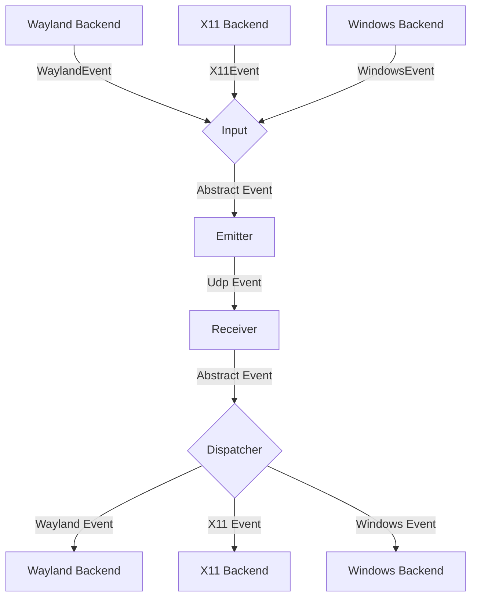
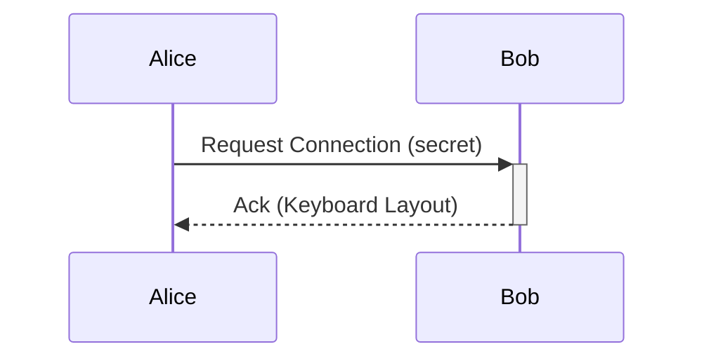

# General Software Architecture

## Clipboard transfer architecture

Clipboard v1 remains the active compatibility path: UTF-8 text up to 4 KiB is
carried in one DTLS datagram. Large application data must not use that path,
because the DTLS implementation does not fragment or retransmit application
records.

The clipboard-v2 protocol lives in
`mousehop-proto::clipboard_transfer`. It defines bounded offers and reliable
stream frames for UTF-8 text, PNG images, and file trees. Mouse/keyboard and
small control messages stay on DTLS; bulk payloads use a separate,
authenticated reliable stream. `CAP_CLIPBOARD_V2`, `CAP_CLIPBOARD_IMAGE`, and
`CAP_CLIPBOARD_FILES` are advertised independently so mixed-version peers skip
formats they cannot publish.

Bulk receivers must validate `TransferLimits` before accepting an offer, write
file chunks into a transfer-specific staging directory, verify item digests,
and decode text/images only after the whole transfer completes. File offers
are handled by `mousehop::file_paste`: receiving an offer must not connect to
the bulk port. The user-session Agent prepares a protected local marker solely
to enable the file manager's native Paste command; it is never a received file.
A captured native paste produces a frontend `PasteFiles` request binding the
exact transfer ID to the confirmed file-manager destination folder. The
one-shot stream opens only for that request. Verified files are then copied
with create-new semantics, retaining a rollback list of only paths created by
this paste. Existing names require a transfer-specific Replace/Rename/Cancel
decision before publication. Replacement moves the existing item into a private
same-directory backup until the entire paste commits; rollback restores it using
a non-overwriting move. Directory replacement replaces the entire directory;
destination symbolic links are moved as entries and never traversed. Cancellation
also removes partial output created by the operation. Manifest paths are normalized relative `/` paths; absolute
paths, traversal components, Windows drive roots, and backslashes are rejected
by the protocol codec. Symbolic links and special filesystem entries are not
sent. Received file trees carry a shared lifetime lease: replacing the local
clipboard releases its lease, while in-flight fan-out tasks retain theirs, and
the staging directory is removed only after the last lease is dropped.

Explicit file paste is negotiated by `CAP_EXPLICIT_FILE_PASTE`; senders never
send file offers to older peers. `FilePasteCancel` uses a new appended event tag
and a version-1 control payload, leaving existing event tags and bulk framing
unchanged. Waiting file-source tasks have no 15-second paste deadline; a new
copy, disconnect, permission revocation, or shutdown aborts them. Source native
clipboard generations are checked before each file chunk. A cancelled listener
cannot serve an obsolete offer even if its revocation datagram is lost.
On Windows/macOS the service also polls the native clipboard generation to
invalidate offers on empty or concealed copies without exposing their content.
The monitor notices recopies of identical content, and queued source file paths
are revalidated against the current clipboard before an offer is announced.
File offers are not forwarded around peer rings. `input_capture::native_paste`
runs input hooks in the desktop user process. Accessibility queries run on
separate workers, not inside low-level hooks. A native paste is intercepted only
for Finder/Explorer and a current offer, excludes editable text fields, and
confirms the foreground window/folder again before sending the request. Physical
input being forwarded to a peer is excluded; tagged Mousehop input emulated on
the receiving host remains eligible. Menu selections are confirmed against the
live, enabled Paste item before cancelling native menu tracking and requesting
transfer. Native clipboard preparation is validated by the user-process bridge
and acknowledged across IPC by offer ID and clipboard generation; SYSTEM does
not attempt to inspect the user process's OLE marker. Its own clipboard mutation
therefore does not revoke the offer. Markers cannot be read as file
contents and clipboard capture ignores them. Markers are cleared only while the
clipboard still has the exact generation Mousehop published, preserving a newer
user copy. The Agent starts an independent progress/cancel UI process without exposing
the settings window. Each new paste raises that popup, even if the previous
completed popup remains open behind another application. macOS activates the
popup in accessory mode without adding a Dock icon; Settings uses the same mode.
Both GUI processes restore this policy after GTK startup/presentation. Windows
briefly raises the popup above normal windows without leaving it always on top.
Periodic progress updates do not take focus again. A successful result closes
immediately; failed/cancelled results remain visible. Completion means
destination files have been written, not
merely received into staging. No FUSE or shell extension is installed.
Windows blocking filesystem work impersonates the logged-in user's limited
access token for source opens and destination writes; it never uses SYSTEM's
filesystem privileges. The guard cannot cross an await and always reverts
before its pooled thread is reused. OLE clipboard reads continue to require
the separate user process described below.

The transport implementation is split between
`mousehop_core::clipboard_bulk` and `mousehop_core::clipboard_receive`. Bulk frames use
u32 length prefixes over a reliable byte stream and AES-256-GCM with a
one-transfer key delivered by the authenticated control channel. Nonces are
domain-separated by stream direction and monotonically sequenced; the transfer
ID and sequence are authenticated as associated data. The transfer key and
ephemeral TCP port are carried only in the authenticated DTLS offer. The
receiver bounds the
encrypted length before allocation, streams chunks to a fresh temporary
directory, requires contiguous offsets, and verifies SHA-256 before making an
item complete. The source waits for a completion acknowledgement before
considering the copy delivered. The bulk acknowledgement confirms validated
staging; explicit file paste reports completion separately after saving to
the chosen folder. Windows text/image clipboard publication is confirmed
separately by the helper.
The local desktop-helper pipe uses v2 frames with publication IDs and revision-tagged
clipboard reports. Pending publications retain their staging leases until applied
or rejected; stale reports cannot release newer files. Captured file lists inherit
the lease so forwarding remains valid after the local clipboard changes. File identity
and capture signatures share `input_event::windows_clipboard_path_key` so the native
clipboard's removed verbatim prefix, separator changes, or ASCII casing do not
release the lease or rebroadcast an already received file. Clipboard
monitor snapshots queued before remote publication are discarded. Bulk copies made
before the outbound handshake retain the latest item per enabled peer for up to
15 seconds while dialing, then check negotiated capabilities before sending.
On macOS the change-count gate is per monitor. A change postponed by the 200 ms
debounce window is retried until processed, even if the pasteboard does not change
again; otherwise a new file copy could remain invisible until the next copy or
daemon restart. Desktop publication logs identify text, image, or file-list content
without logging text contents.
When a native file list is unavailable in the installed Windows SYSTEM helper,
it starts the same installed executable as `windows-clipboard-read` with the
login user's primary token on `winsta0\\default`. Elevated user tokens use their
limited linked token. The reader initializes an OLE apartment and requests
CF_HDROP from the clipboard's IDataObject, matching Explorer's file-copy model.
The one-shot reader runs before console attachment, GUI, config or service
initialization. Only stdout and NUL handles are inherited via an explicit handle
list. Its bounded JSON response (1 MiB, 4096 absolute paths) is delivered over an
anonymous pipe. A job kills it on failure or timeout, and the helper accepts and
caches only snapshots matching the native clipboard sequence throughout the
read. It never applies clipboard data or opens a network/service listener.
If a file format or the user read fails, polling retries rather than publishing
a text fallback.
User-reader snapshots are logged at debug level without clipboard contents.
A desktop report arriving before the network service subscribes is buffered (latest only)
and delivered upon subscription; remote publication or desktop replacement
invalidates that buffer.

`input-capture::clipboard` queries the OS clipboard in file-list, bitmap, then
text order. This preserves native file copies that also expose a URI-list text
fallback. `arboard` maps the file list to CF_HDROP on Windows, file URLs on
macOS, and `text/uri-list` on Linux. Bitmaps are normalized to RGBA8 in memory,
encoded losslessly as PNG for transfer, and decoded only after the offer,
payload size, dimensions, and digest have passed validation.

## UI localization

`mousehop-gtk/translations/zh-TW.tsv` maps English message keys to Traditional
Chinese. `mousehop-gtk/build.rs` compiles English and translated GTK resource
bundles; the frontend registers the selected bundle before initializing any
composite templates. Runtime labels and native tray menus use the same catalog.
Missing translations fall back to English. Named placeholders must be retained
in translated messages. The language preference is local to the frontend and
requires a restart, so daemon and protocol serialization are unchanged.

To add another language, add a catalog, compile its resource bundle, extend the
language selection/resolution in `src/i18n.rs`, and register the corresponding
bundle during frontend startup. Catalog tests check duplicate keys and placeholder
consistency; resource tests check translated templates and markup.

## Events

Each instance of mousehop can emit and receive events, where
an event is either a mouse or keyboard event for now.

The general Architecture is shown in the following flow chart:

### Input
The input component is responsible for translating inputs from a given backend
to a standardized format and passing them to the event emitter.

### Emitter
The event emitter serializes events and sends them over the network
to the correct client.

### Receiver
The receiver receives events over the network and deserializes them into
the standardized event format.

### Dispatcher
The dispatcher component takes events from the event receiver and passes them
to the correct backend corresponding to the type of client.

Native menus must not stall input sharing. Frontend IPC uses a separate bounded
writer queue per connection; a frontend that stops reading is disconnected on
overflow without blocking Core or other frontends. Windows desktop-helper input
and Destroy commands await queue capacity in order, rather than dropping button
releases during motion bursts. Held mouse buttons are tracked per emulation
handle and released when that handle leaves or disconnects. Windows defers edge
capture while a local mouse button is down, a window owns mouse capture, or the
foreground thread is tracking a menu or moving/resizing a window. A failed
capture-Begin enqueue leaves the pointer local.

Windows keeps local key gestures balanced across crossings: a key-down delivered
before capture has its physical key-up passed to local Windows as well as the
peer. Remote-only key gestures remain captured. Windows capture sends aggregate
modifier state after modifier transitions and before mouse buttons; macOS mouse
buttons similarly carry a fresh modifier snapshot before the click. These repair
lost releases without clearing a modifier group still reported held. Command/Ctrl
alias tracking also consumes cleared snapshots so the next shortcut can begin.
The Windows injection backend retains its own per-key ownership and failed key-up
obligations. It retries only those releases on later input/snapshots and cleanup,
without blocking/retry loops or blanket resets of all system modifiers. Shared
key tracking commits only after backend success; failed cleanup retains its keys.

### macOS Caps Lock

Quartz-injected Caps Lock events do not reliably enter the hardware-only path
that macOS uses for its “Caps Lock to switch input sources” setting. They can
toggle the uppercase latch instead, or change the active input method without
refreshing the menu-bar indicator.

When macOS receives a complete remote Caps Lock press from Windows, Mousehop
therefore consumes the down/up pair and switches through Text Input Source
Services on release. A non-Latin input source switches to macOS's most recently
used ASCII-capable source; the next press returns to the most recently observed
non-ASCII source. When Mousehop starts while a Latin source is active, it reads
macOS's input-source history to recover the previously used non-Latin source;
it does not choose the first non-Latin source from the enabled list. Since
Mousehop never injects AlphaShift for this path, a
remote tap cannot accidentally enable continuous uppercase typing. Carbon's
input-source selection updates the system input source and its menu-bar state
together. This uses the existing keyboard protocol.

Manual regression check: with ABC and a Chinese input method enabled on the
Mac, control it from Windows and press/release Caps Lock repeatedly. After each
press, verify both typed characters and the menu-bar input-source icon. Also
verify that holding Caps Lock does not start key repeat and that crossing or
disconnecting with Caps Lock released does not trigger an extra switch.

When macOS controls a remote peer, Mousehop temporarily adds a system HID usage
mapping from physical Caps Lock to F18. macOS implements “Caps Lock to switch
input sources” below the Quartz event-tap interception point, so dropping the
Quartz event alone cannot suppress it. The mapped F18 bypasses that handler;
Mousehop translates it back to Caps Lock only on the wire and drops it locally.
The complete pre-existing `UserKeyMapping` property is restored when capture
returns, the client disconnects, the event tap is interrupted, or Mousehop
shuts down. The Windows sink treats Caps Lock as a discrete lock key and never
starts its synthetic repeat timer for it. This makes the Windows lock state
toggle once per press while the Mac's input source and uppercase state remain
unchanged.

Manual regression check: set the Mac's Caps Lock action first to the normal
uppercase latch and then to input-source switching. In each mode, move capture
to Windows and press Caps Lock repeatedly, including short taps and long holds.
Verify that Windows toggles uppercase once per press, the Mac menu-bar input
source icon does not move, and returning the pointer to the Mac does not reveal
a changed local uppercase state.

## Requests

// TODO this currently works differently

Aside from events, requests can be sent via a simple protocol.
For this, a simple tcp server is listening on the same port as the udp
event receiver and accepts requests for connecting to a device or to
request the keymap of a device.

## Problems
The general Idea is to have a bidirectional connection by default, meaning
any connected device can not only receive events but also send events back.

This way when connecting e.g. a PC to a Laptop, either device can be used
to control the other.

It needs to be ensured, that whenever a device is controlled the controlled
device does not transmit the events back to the original sender.
Otherwise events are multiplied and either one of the instances crashes.

To keep the implementation of input backends simple this needs to be handled
on the server level.

## Device State - Active and Inactive
To solve this problem, each device can be in exactly two states:

Either events are sent or received.

This ensures that
- a) Events can never result in a feedback loop.
- b) As soon as a virtual input enters another client, mousehop will stop receiving events,
which ensures clients can only be controlled directly and not indirectly through other clients.

## Windows service installation and validation

Windows icon resources are committed in `mousehop/assets/windows` and linked
into `mousehop.exe` by `embed-resource` for Windows targets (MSVC `rc.exe`,
LLVM `llvm-rc`, or MinGW `windres`). Regenerate them from the existing SVGs with
`bash scripts/make-windows-icons.sh` from the repository root; this requires
`rsvg-convert` and ImageMagick. Resource ID 1 is the app icon; IDs 2/3 are the
black/white tray glyphs, loaded at the system small-icon size without GTK SVG
loaders. The tray owns and releases each loaded HICON.

Manual icon verification on Windows 10/11: check Explorer and Task Manager
(including daemon/worker processes), toggle light/dark taskbar themes, inspect
the tray at 100% and 200% scaling, close/reopen settings through the tray, and
restart Explorer to confirm the icon returns. Test the portable DLL-only ZIP
as well as the installed application.

Build on macOS with `scripts/package-windows-installer.sh`. Prerequisites are the
existing `package-windows.sh` cross-build tools and NSIS (`brew install nsis`).
The runtime ZIP may provide gettext as `intl.dll`, `intl-8.dll`, or
`libintl-8.dll`. Import-library generation preserves the actual DLL filename;
these variants do not require installing another gettext dependency.
Downloaded or explicitly supplied runtime ZIPs are retained under
`target/windows-package-cache/`, alongside the extracted DLLs/import libraries.
`dist/` contains output artifacts only and is never searched for dependencies;
clearing it does not trigger another runtime download. The runtime is downloaded
only when its cached ZIP is absent, or replaced using `--runtime-zip`.
`--package-zip` skips compilation and wraps a current, service-capable ZIP;
`--runtime-zip` selects runtime DLLs during compilation; `--output` chooses the
Setup EXE path. The normal portable ZIP is still produced. NSIS sources are in
`scripts/windows/`; `mousehop-installer/` contains the native x64 lifecycle helper.
The helper is rebuilt from source even when using `--package-zip`, with a static
CRT so it can run before the GTK/runtime DLLs are installed.
The generated installer is unsigned unless separately signed by the distributor.

NSIS extracts the standalone `mousehop-installer.exe` and runs Prepare, Install
and Uninstall. These phases use Windows SCM, file-security, process, IP Helper and
Firewall COM APIs directly. No PowerShell, WMI/CIM, `sc.exe` or `netsh` is invoked.
The helper outputs phase, paths, PIDs and Windows errors to installation details.

Prepare stops the verified installed service and remaining processes whose full
executable path matches the installed `Program Files\Mousehop\mousehop.exe`.
This includes installed Settings windows; save pending changes before upgrading.
A same-named portable process elsewhere is not an installation blocker. If an
actual TCP/UDP listener occupies the configured machine port (4252 by default),
Prepare identifies its PID and path. For a portable Mousehop listener it offers
a native confirmation to stop that specific process. Other applications are
left running and reported as port conflicts. Silent installation reports conflicts
without prompting or terminating portable processes. Uninstall stops only installed
processes and preserves machine configuration and pairing data.

SCM starts `mousehop.exe windows-service` as LocalSystem. The supervisor polls
`WTSGetActiveConsoleSessionId` and launches a SYSTEM `windows-session` process
with a primary token assigned to that session. That process owns frontend IPC,
DTLS listeners, outbound connections, authenticated peer state and discovery for
the entire console session. Its desktop supervisor inspects `OpenInputDesktop`
and launches an input-only `windows-worker` on `winsta0\default` or
`winsta0\Winlogon`. Only the input helper is replaced on desktop changes:
lock/unlock and UAC transitions retain the existing DTLS sessions and input
ownership. An inaccessible desktop causes an input gap, not a network restart.
A console-session change or network-process failure still requires reconnecting.

The per-session `Mousehop.Desktop.v3` named pipe admits SYSTEM only, rejects
remote clients, and verifies both endpoint identities. Each helper connection has
a generation: stale capture, clipboard and completion messages are discarded.
Capture-edge configuration is replayed to a new helper; input events are never
queued across a desktop transition. Pending key releases precede new input.
Clipboard monitoring and publication run only in a Default-desktop helper;
secure desktops and replacement gaps reject clipboard traffic. Downloaded file
leases remain owned by the persistent network process. User-configured shell
hooks remain disabled in service mode.

Winlogon capture initializes as locked, rather than waiting for a lock notification
that preceded helper startup. Mouse and keyboard hooks ignore injected events;
Mousehop tags its own SendInput events. Absolute entry warps use tagged virtual-
desktop coordinates targeting pixel centers, including negative monitor origins.
The hook confirms capture release before a handover warp and resets its motion
baseline, preventing an injected landing from triggering a reverse crossing.

Windows input injection attempts each event once. A rejected `SendInput` event
is skipped rather than retried in a blocking loop, so desktop transitions cannot
starve DTLS heartbeats or the helper stop request. The first rejection and next
successful injection are logged; a rejected key also stops synthesized repeat.

Service stop/shutdown and desktop replacement use restricted named stop events
and desktop-helper teardown (`capture.terminate` and `emulation.terminate`).
Network, DNS and latency teardown occurs only when the session daemon ends. The broker allows four seconds for worker cleanup; the
supervisor allows ten seconds for broker cleanup. A kill-on-close job bounds each
child process tree, including recovery after a broker/supervisor crash. Forced
termination cannot guarantee key releases, so held-key scenarios require the
manual checks below. Session changes and worker failures are logged to the
service log readable by standard users. `Running` in SCM indicates the supervisor is up;
check the log for successful worker startup if input does not work.

When testing lock/unlock transitions, keep a key held while switching desktops
and verify it is released, the old worker exits without forced termination, and
the existing DTLS connection stays established while a new helper attaches.
There should be no `dtls client disconnected` or new handover solely because the
desktop changed, and no automatic return crossing from a tagged warp.
Repeat with the pointer moving
and with no input. A `SendInput rejected an event` message should not prevent
heartbeats or shutdown; check for `SendInput recovered` if that worker remains
on the active desktop. Perform these checks on Windows; cross-compilation alone
does not exercise Winlogon input or key cleanup.

The background entry point connects to the SCM service and waits up to 30 seconds for
its running status, then up to 30 seconds for the worker IPC endpoint. Failure is
shown in a native dialog. The entry point and workers default to the machine
`config.toml` and `identity.pem`; portable profiles are not imported automatically.
The Windows GUI uses named mutexes/events scoped to the user/session and installed
or portable mode, avoiding TCP-port conflicts and stale connections after killing
the GUI. The blocking frontend reader and writer use independent OVERLAPPED
operations; a pending read must not serialize outgoing configuration requests.
GTK rejects requests with a toast while reconnecting, and allows 60 seconds for
Windows worker recovery. Worker exit codes and desktop transitions are logged;
all installed roles install a panic hook before service dispatch and write
`%ProgramData%\Mousehop\panic-YYYY-MM-DD-PID.log`. Standard users can open the shared directory
and read both logs/configuration in Explorer, but cannot modify shared state.
The installer protects an existing `identity.pem` with an explicit protected
SYSTEM/Administrators DACL before adding inherited Users read/execute rights to
the directory. A new identity is created with that private DACL before writing
key bytes, so it never inherits public read access. Service binaries remain
administrator-writable only, and machine configuration changes still require administrator consent.

Installed binaries carry a `service-mode` marker in the protected installation
directory. The non-elevated background Agent owns the native tray and file-paste
bridge, while `mousehop-ui` owns only preferences/progress windows. Starting the
Agent attaches to the service without spawning a second network Core. Settings
reads shared state without elevation; a machine mutation uses a short-lived
`mousehop.exe admin-request <hex-json>` process launched with UAC consent. The
helper accepts only typed administrator operations and saves the result. Normal
Agent/Settings processes never receive private-key material.

The numeric release-pixel threshold is a desktop runtime preference, like
pause/resume, and uses the existing user IPC connection without UAC. Core applies
and persists it; no direct user write access to machine configuration is granted.
Settings tracks outstanding threshold values in send order on every platform, so
an older Sync/echo cannot move the slider away from the user's newest edit. A
failed send or IPC reconnect clears that pending state and accepts Core's next
canonical value. Zero continues to disable the wall-press release fallback.

Windows local IPC uses `Mousehop.Service.v2` named pipes rather than TCP. Interactive
clients must match the active physical-console session and its account. Each
connection is classified by its real token; only SYSTEM/elevated administrators
can send machine configuration commands. Remote pipe clients are rejected and
clients verify the server identity before sending a version handshake. Portable
endpoints remain isolated by user SID. Unix IPC sockets are mode 0600. All local
frontends must negotiate IPC v4 before commands are accepted; old frontends must
be updated with the runtime. Remote protocol serialization is unchanged.

Pausing releases capture and all emulated handles, invalidates file offers and
cancels transfers. In-flight clipboard receive tasks carry an epoch so they cannot
publish after a pause. Quitting an installed app keeps Core's control endpoint
alive but sharing idle; a protected volatile registry value retains intentional
pause/stop across service crashes and is discarded by Windows at reboot.

The installer fixes the binary location under Program Files, quotes the SCM
image path, creates protected ProgramData state, rejects reparse points and
untrusted ownership/write ACLs in existing installation/state trees, and refuses
to replace an unrelated service named Mousehop. Machine credentials and settings
are deliberately separate from user profiles. Settings/credentials remain after
uninstall to preserve pairing; an administrator can explicitly delete them to
reset trust. Installation creates Domain and Private/LocalSubnet firewall rules
scoped to the executable. The Network access page offers an explicit Public
network opt-in (still LocalSubnet only), off by default and remembered across
upgrades in `HKLM\Software\Mousehop\Installer`. The native Install helper accepts
`--allow-public` only for that phase; Prepare and Uninstall reject it. Setup
reports active profiles, profiles covered by its rules, inbound-block-all policy
and local-rule policy restrictions. It never changes network categories or global
firewall policy. An outbound connection succeeding does not prove inbound rules
cover the receiving interface; authorizing a fingerprint cannot bypass a firewall
drop. The service logs manually added fingerprints and rejected DTLS fingerprints
to distinguish blocked packets from credential mismatches. Shell enter-hooks
never execute in service workers. Clipboard send/receive, including file transfer,
is disabled on secure desktops and resumes on the normal desktop.

Windows runtime acceptance (requires a Windows 10/11 x64 machine and a paired peer):

1. Install from a standard account using administrator consent. Confirm files in
   Program Files, service account LocalSystem, automatic startup, and private-LAN
   firewall rules. Confirm standard users cannot modify executable/DLLs or read
   ProgramData credentials. Unprivileged pipe clients must be unable to change machine configuration.
   Settings must open without elevation; pairing/configuration changes must request UAC. Portable instances must work without elevation.
   Confirm standard users can list `ProgramData\Mousehop` and read `config.toml`,
   `service-*.log`, `session-*.log`, `worker-*.log` and `panic-*.log` without elevation, but cannot modify those files.
   Repeat on an upgrade with existing configuration/key files and confirm that
   `identity.pem` remains unreadable and its contents/pairing are preserved.
2. Pair a peer from Settings with UAC consent for the authorization change, save configuration, close Settings, and
   confirm sharing continues. Reboot without logging in and control the console
   login screen using that peer. Windows Hello/credential-provider restrictions
   remain those of Windows. If policy requires Ctrl+Alt+Del, send the secure
   attention sequence locally; Mousehop does not synthesize it.
3. Log in, exercise ordinary and elevated applications, lock with Win+L, unlock,
   and open/cancel/accept UAC on the secure desktop several times. Check keyboard,
   mouse, all display edges, reconnection and absence of stuck modifiers/buttons.
   Verify that clipboard data does not transfer while on a secure desktop.
4. Repeat desktop transitions with modifiers/buttons held. Disconnect the peer,
   stop/restart Mousehop from Services, and verify key/button cleanup. Kill a worker
   and then a session broker from Task Manager; the supervisor must recover them
   without leaving duplicates. Stop the service and ensure no workers remain.
5. Switch local users, including logging out the last user; verify only the active
   console session has a worker and that the same machine pairing is available.
   RDP and simultaneous session sharing are outside this implementation's scope.
6. Upgrade with the service and installed Settings running, then uninstall. Verify
   successful stop, removal of service/firewall rules/shortcuts/binaries, retained
   protected machine state, and successful reinstallation using that state.
7. Leave an unrelated same-named portable executable running with a different
   port: Prepare must not block it. With a portable listener on the service port,
   check the PID/path confirmation; declining must leave it running. In silent
   mode a port conflict must fail with those details and no confirmation dialog.
   Confirm installation succeeds when PowerShell is disabled by machine policy.
8. Pair two builds supporting explicit file paste. Copy a Chinese-named CSV
   and a folder containing files and an empty directory in Explorer/Finder.
   Confirm copying alone sends no file-content bytes even after 15 seconds.
   Keep the receiving Settings process closed. In its Finder/Explorer open a
   writable folder and use the normal paste shortcut, the Edit menu, and the
   context menu. Confirm that each triggers Mousehop automatically, without a
   Mousehop button/folder picker, and verify its independent progress window,
   saving, completion and resulting file contents.
   Repeat in reverse and in installed/portable Windows modes. Local-only
   copies/pastes must not transfer files. Copy text/images, clear the clipboard,
   or copy a concealed value before/during a pending paste; it must expire or
   cancel, clean partial output, and never send the concealed content. Recopy
   the same file to create a fresh offer. Change the clipboard or destination
   window between interception and confirmation; the old request must fail.
   Confirm rename/search/text fields paste normally, and input still being
   captured for a peer never pastes into the source host's stale file window.
   On macOS verify Accessibility/Input Monitoring and Finder-automation grants;
   on Windows verify both classic and modern Explorer context menus.
   Test cancellation during receive/save, a read-only folder, existing names,
   disconnect, permission revocation, lock/UAC and console-user changes. No
   destination write may exceed the ordinary user's filesystem permissions.
   Verify text/image clipboard sync and Windows user-reader behavior still work.

Automated checks: `cargo test -p mousehop-ipc -p mousehop --lib`,
`cargo clippy --workspace --all-targets --all-features`, and a Windows-target
cross-build. The Windows IPC test exercises exclusive binding, multiple clients,
request/response delivery and pipe-server identity verification. Run it on Windows
with `cargo test -p mousehop-ipc`; a macOS run cannot exercise Windows APIs.
`cargo test -p mousehop-installer` covers full-path process selection and network
byte order on all hosts. On Windows it also tests actual TCP/UDP listener ownership
and current-process image-path queries without modifying services or firewall rules.

## Runtime / UI separation validation

The workspace is split into `mousehop-core` (shared library), `mousehop` (native
Agent/runtime), `mousehop-gtk` (`mousehop-ui` settings/transfer executable), and
`mousehop-cli`. Settings never owns the Core, native tray, or NativePasteBridge.
The Agent attaches once per user/session and installation mode, invalidates old
native offers on attachment/disconnection, and sends heartbeats. File pastes are
bound to the transfer ID and clipboard generation. An Agent loss invalidates file
transfers; an Agent-owned Core exits after heartbeat loss, while installed input
sharing can continue independently of the user's desktop UI.

Both Windows packages ship the same three executables. The installer starts the
Agent at login and upgrades/uninstalls only matching full paths, including UI/CLI.
macOS ships the helpers within the existing app bundle; dependency copying and
inside-out signing include all executables.
Each macOS executable, including `mousehop-ui`, carries its own
`@executable_path/../Frameworks` run path. Packaging executes every bundled
executable with `--version` after signing to catch dyld dependency failures;
checking only the background executable does not validate its UI helper.
On a graphical macOS/Windows host, `mousehop-ui --check-template` additionally
initializes GTK and constructs the preferences template without connecting to
Core, registering peers, or starting input capture/emulation.
Windows capture publishes its thread ID only after creating the Win32 message
queue. Updates to an exited thread return a capture error; shutdown tolerates a
missing queue and joins the thread without panicking. The lifecycle regression
tests use message queues without installing input hooks; run them on Windows
with `cargo test -p mousehop-input-capture lifecycle_tests`.
Per-user login startup uses a Run
entry on portable Windows and a RunAtLoad LaunchAgent on macOS, without KeepAlive.
macOS TCC revocation watching is owned solely by Core and runs independently of
GTK. An initially unauthorized session starts no probe worker. Authorized sessions
observe TCC database/WAL changes, with a 30-second fallback; probe subprocesses have
a three-second deadline and abnormal exits never count as revoked permission.
Confirmed revocation pauses sharing once, ends capture and opens Settings instead
of exiting Agent/Core. Further permission edits do not recreate backends or spawn
more probes in that session. After granting permissions, use Settings to restart
the complete app. Late DTLS events after receiver shutdown end their read loop
without panicking. Verify helper signing and the actual
TCC attribution on macOS; do not assume an existing grant survives a changed signature.

After implementation, run unit tests for the workspace, formatting, Clippy for
all targets/features, and a Windows-target build. Runtime acceptance requires:

1. Start paired Windows installed/portable and macOS apps with no Settings process;
   use mouse/keyboard, text/images, and Explorer/Finder native file paste.
2. Open/close and forcibly terminate Settings during a transfer. Transfer continues;
   explicitly closing/cancelling the separate progress window cancels it.
3. Pause while holding keys; confirm peer/local key release. Resume, then Quit and
   confirm sharing stays stopped. Restart an installed service within the same boot;
   it must retain pause/stop. Relaunch Mousehop to resume.
4. Repeat Windows login/lock/UAC desktop transitions. Keep network sessions alive,
   reject clipboard/file paste on secure desktops and during helper replacement.
5. Run Settings as a standard console user: viewing needs no UAC; modifying machine
   pairing/configuration does. Reject other accounts/sessions and non-elevated raw
   machine commands. Preserve desktop-user filesystem permissions for paste.
6. Verify repeated launches reuse Agent/Settings, Explorer restart restores the tray,
   login startup runs without duplicate agents, and upgrade/removal handles UI/CLI.
7. Revoke/grant macOS Accessibility, check safe tap teardown and backend recreation;
   confirm clipboard privacy lists use application metadata supplied by the Agent.

macOS permission restart is owned by the background Agent: Settings requests a
restart over local IPC, then the Agent stops Core and all owned GUI helpers,
releases its single-instance lock, and launches a fresh Agent with Settings open.
Quit flushes the terminal runtime state to connected frontends before Core exits;
the Agent also reaps its GUI children, with forced cleanup after a three-second
grace period. Closing Settings alone continues to leave sharing running.

On Windows, tray Quit closes Settings and transfer windows in both installed and
portable mode. The installed service remains resident with sharing stopped, but
its terminal state is broadcast before another IPC request is handled. The Agent
reaps its UI helpers and terminates unresponsive helpers after the grace period.

Windows Settings connection failures: pipe error 231 is a busy endpoint, not an
absent runtime. Busy/denied endpoints never bootstrap another Agent or Core.
Service pipe identity is verified using its explicitly SYSTEM-owned security
descriptor, so a desktop user does not need access to the SYSTEM process token.
Desktop clients receive data/read-control rights without permission to create
additional service pipe instances. Both synchronous and asynchronous clients use
the same access mask and identity validation.

Windows installers embed a SHA-256 manifest of all shipped executables and DLLs.
After stopping old processes and copying files, the native Install action verifies
every installed payload hash before registering/starting the service. A partial
or mixed-version upgrade fails with the affected filename in installation details.

The Windows internal desktop pipe also uses an explicit SYSTEM owner, through
`SecurityDescriptor::system_only()`. Inheriting the SYSTEM token's default owner
can produce an Administrators-owned pipe and make the input helper reject it,
causing repeated worker exits and unavailable input. Background helper processes
use `STARTF_FORCEOFFFEEDBACK` to suppress launch feedback on the mouse cursor.
The LocalSystem-only Windows regression test
`desktop_worker_authenticates_the_actual_internal_pipe` exercises the actual
internal pipe and its client identity check (run with `--ignored --exact` under
LocalSystem on a Windows test machine).

macOS application directories ending in `.app` with `Contents/Info.plist` are
archived as `<name>.app.zip` before a file offer is sent. The native `ditto` ZIP
writer preserves bundle symbolic links, executable bits and resource metadata;
receivers save the ZIP as an opaque file and do not extract it automatically.
Ordinary files/directories retain their existing transfer representation. Archive
preflight uses the file-transfer size/entry limits, and temporary archives remain
leased until all outgoing streams finish or are cancelled. Clipboard preparation
runs outside the Core event loop so input and desktop Agent heartbeats continue
during compression. A newer copy, pause or shutdown cancels preparation and its
archive subprocess. Preparation failures appear in a separate transfer window.
Completed transfer windows close immediately; failed transfers remain visible.

Mac Agent/Core runtime logs are saved to `~/Library/Logs/Mousehop/agent-YYYY-MM-DD-PID.log` and
`core-YYYY-MM-DD-PID.log`, including when Finder/Launch Services directs stderr to `/dev/null`.

macOS startup opens Settings whenever Accessibility or Input Monitoring permission
is missing, including when a pre-existing configuration makes the installation
appear already configured. Permission checks use non-prompting preflight APIs.

Local IPC v4 adds `FilePasteConflict`, `ResolveFilePasteConflict`, and the
`WaitingForConflict` transfer phase. The Core owns staged files and destination
publication. The transfer GUI displays Replace/Rename/Cancel and a prefilled rename
field; replies must match both the active transfer ID and outstanding question ID.
Pending questions are replayed on Sync. A renamed item that also exists prompts
again. Cancel, close, new clipboard contents and shutdown cancel the paste and
restore prior items. Rollback never overwrites a concurrently created file; if
restoration is blocked, the originals remain in the reported backup directory.

Desktop Agent heartbeats run on a dedicated thread after IPC negotiation, using
a mutex shared with command writes on the same connection. Native menu tracking
therefore cannot stop the one-second heartbeat or trigger the five-second Core
watchdog. Heartbeat expiry and explicit IPC Quit are logged separately. Late DTLS
events received after capture shutdown end the network reader without panicking.
On Unix, `ConnectionRefused` is treated as an absent endpoint: a stale socket left
by a crashed Core can be reclaimed by the listener and the Agent can start Core
again. Permission-denied and busy endpoints remain non-bootstrap errors.

Translation catalogs use `key<TAB>value` entries and may contain blank separator
lines. Template generation and runtime lookup share the same parser; malformed
nonblank entries report their original line number during the build.

`mousehop-logging` owns the common Mac/Windows retention policy. File logging is
on at INFO by default, including GUI/transfer processes. Each process writes a
role/date/PID file, rotating at UTC midnight on its next write. One maintenance
thread per process/directory runs immediately and every 60 seconds, deleting only
recognized Mousehop files outside the seven retained UTC dates (today plus six).
Legacy fixed-name logs are compacted using each record's timestamp, with panic
backtraces retained as a unit. Recent/in-use legacy logs are deferred, file locks
prevent competing cleanup, snapshots are rechecked, and filtered content is
published atomically. Unchanged legacy files are cached until their contents or
retention cutoff changes. Cleanup never follows log-named symlinks and does not
remove configuration, certificates, unknown logs or unrelated files.

Windows return-edge detection observes Mousehop-tagged relative pointer injection
without forwarding those injected events again. Reaching the last contained
pixel while moving outward triggers the real exposed edge; monitor seams and
absolute landing warps do not. The SYSTEM desktop pipe v3 carries Begin cursor
coordinates and normalized fractions through to the network process, matching
portable Windows. Returning is therefore driven by receiver cursor position,
while release px remains a fallback for missing peer-side capture. Handover and
fallback landing points sit eight coordinate units inside the destination
contour (less on tiny outputs), preserving the cross axis and avoiding an
immediate bounce on a small reverse motion. Sender cursor modeling uses the same
inset for confirmed peer topology. Upgrade the complete Windows package so the
session process and desktop helper both use pipe v3.
